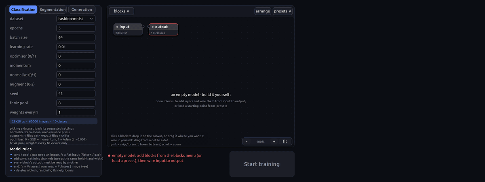

# tinyDL

**A small deep-learning framework in plain C + CUDA, with a live GUI: wire blocks together, train, and watch what the network is doing.**



- **Build by wiring blocks** - conv, bn, pool, add / cat skips, fc, layer norm, attention, a VAE sampling step. Shapes and
  parameter counts are checked as you wire; a CNN, a ResNet, a U-Net, a VAE and a small vision transformer ship as presets.
- **Watch it train** - loss, accuracy, the current sample, GPU load, and for any layer: its filters in 3D, *what the
  convolution produced for the sample on screen*, the fc layers as dots and lines, and what each attention head looks at.
- **Three problems** - classification, segmentation (brain-tumour MRI) and generation (VAE), with Adam / SGD and data augmentation.
- **Small enough to read** - reverse-mode autograd, the CUDA kernels and the whole GUI in a few C files, no C++ or STL in the
  framework: the point is to see how kernel design affects training, on a codebase you can read in an afternoon.


## Quick start

```bash
sudo apt install -y libsdl2-dev libsdl2-ttf-dev      # GUI only
# download a dataset (see docs/datasets.md), e.g. Fashion-MNIST, then:
make train_gui
```

The GUI opens in a 1150x700 window; press `F11` to switch to fullscreen (the whole picture is scaled to fit your
screen, keeping its proportions) and back, or start fullscreen with `./train_viewer --fullscreen`.

Requirements: an NVIDIA GPU, the CUDA Toolkit (`nvcc` on `PATH`) and `gcc`. If `nvcc --version` is
newer than the CUDA version `nvidia-smi` reports (common on WSL2), build with a matching toolkit:
`make NVCC=/usr/local/cuda-12.9/bin/nvcc`.

## Layout

```plaintext
module/   tensor + autograd, ops (matmul, relu, flatten, add, concat, reshape), Linear, Conv2D, BatchNorm, pooling, upsample, VAE sampling, CUDA kernels; transformer.cu: layer norm, gelu, position embedding, patchify, grayscale, attention
test/     tests, plus the GUI: train_worker.c (CUDA trainer), train_viewer.c (SDL2), train_record.h (shared config)
tool/     dataset converters (NEU-CLS, CIFAR-10, brain MRI), GPU info
```

The optimizers (SGD with momentum, and Adam with bias correction) are `tensor_update_momentum()` and `tensor_update_adam()` in `module/tensor.cu`.

## Tests

```bash
make test        # builds test_main and runs it
```

- **`test_graph_ops`** — finite-difference gradient checks for add, concat, batchnorm (4D and 2D), layer norm, gelu, position embedding, multi-head attention and a whole transformer block, max pool,
  upsample, global average pool, conv2d (stride / padding / 1x1), a residual block where one tensor feeds
  two consumers, a pool-upsample-concat skip, reshape, the VAE sampling step (including its KL gradient)
  the segmentation loss (cross entropy + Dice), and Adam (the first step moves every weight by about the
  learning rate whatever the gradient's size; it minimizes a quadratic).
- **`test_linear`**, **`test_conv2d`** — an MLP and a tiny ConvNet on synthetic tasks.
- **`test_mnist`** — a 4-layer strided ConvNet on MNIST, ~97% test accuracy in 3 epochs. Skipped with a
  message if `data/mnist/` is missing.

## Documentation

| page | what is in it |
|---|---|
| [Live training GUI](docs/gui.md) | the settings screen, the three problems, every training field, optimizers, the two-process design |
| [Model editor](docs/model-editor.md) | the blocks (basic, preprocessing, advanced), wiring, presets, errors, residual units |
| [Transformer](docs/transformer.md) | tokens, `patch` / `attn`, the `vit` preset, the attention view |
| [Training dashboard](docs/dashboard.md) | the model graph, loss curve, GPU strip, stop button, the predictions page |
| [Weights viewer](docs/weights-viewer.md) | conv filters in 3D, a conv layer's result for the current sample, the fc network view |
| [Generative model (VAE)](docs/vae.md) | the `vae` block, the generations page, results |
| [Datasets](docs/datasets.md) | the file format, how to get each dataset, segmentation datasets |

## Development

```bash
make format                    # clang-format
pre-commit run --all-files     # same check as the commit hook
make clean
```
