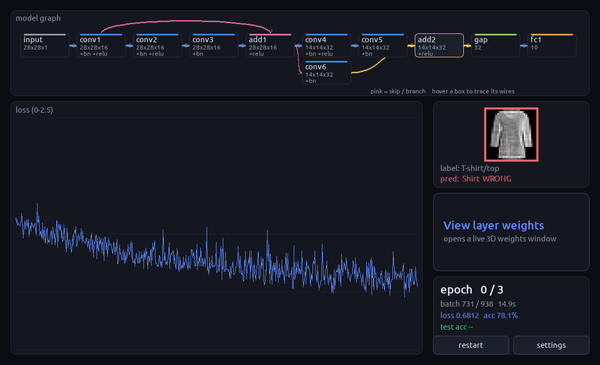
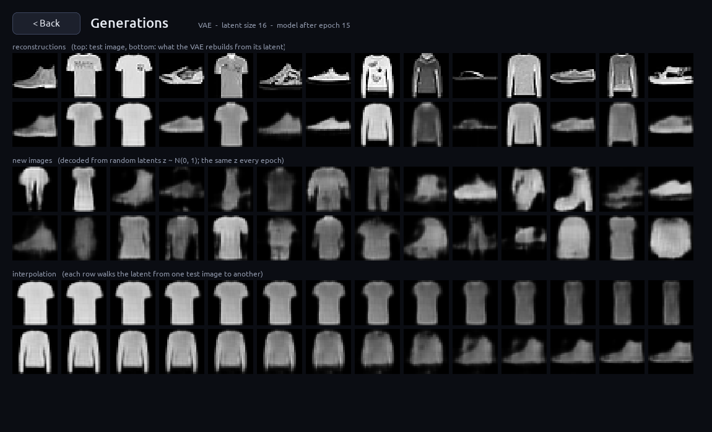

# tinyDL

A small deep-learning framework written in plain C + CUDA (no C++/STL in the framework itself):
reverse-mode autograd, Linear / Conv2D / BatchNorm / pooling / upsampling / residual add / channel concat,
SGD with momentum, classification, segmentation and a VAE, and a live SDL2 GUI where you build a model by
wiring blocks together (a CNN, a ResNet, a U-Net, a VAE), train it, and watch the loss, the predictions /
generated images and the weights while it runs.

The aim is to see how CUDA kernel design affects neural-network training, on a codebase small
enough to read in an afternoon.


## Quick start

```bash
sudo apt install -y libsdl2-dev libsdl2-ttf-dev      # GUI only
# download a dataset (see "Datasets" below), e.g. Fashion-MNIST, then:
make train_gui
```

The GUI opens in a 1150x700 window; press `F11` to switch to fullscreen (the whole picture is scaled to fit your
screen, keeping its proportions) and back, or start fullscreen with `./train_viewer --fullscreen`.

Requirements: an NVIDIA GPU, the CUDA Toolkit (`nvcc` on `PATH`) and `gcc`. If `nvcc --version` is
newer than the CUDA version `nvidia-smi` reports (common on WSL2), build with a matching toolkit:
`make NVCC=/usr/local/cuda-12.9/bin/nvcc`.

## Layout

```plaintext
module/   tensor + autograd, ops (matmul, relu, flatten, add, concat, reshape), Linear, Conv2D, BatchNorm, pooling, upsample, VAE sampling, CUDA kernels
test/     tests, plus the GUI: train_worker.c (CUDA trainer), train_viewer.c (SDL2), train_record.h (shared config)
tool/     dataset converters (NEU-CLS, CIFAR-10, brain MRI), GPU info
```

The optimizers (SGD with momentum, and Adam with bias correction) are `tensor_update_momentum()` and `tensor_update_adam()` in `module/tensor.cu`.

## Tests

```bash
make test        # builds test_main and runs it
```

- **`test_graph_ops`** — finite-difference gradient checks for add, concat, batchnorm (4D and 2D), max pool,
  upsample, global average pool, conv2d (stride / padding / 1x1), a residual block where one tensor feeds
  two consumers, a pool-upsample-concat skip, reshape, the VAE sampling step (including its KL gradient)
  the segmentation loss (cross entropy + Dice), and Adam (the first step moves every weight by about the
  learning rate whatever the gradient's size; it minimizes a quadratic).
- **`test_linear`**, **`test_conv2d`** — an MLP and a tiny ConvNet on synthetic tasks.
- **`test_mnist`** — a 4-layer strided ConvNet on MNIST, ~97% test accuracy in 3 epochs. Skipped with a
  message if `data/mnist/` is missing.

## Live training GUI

`make train_gui` opens the **settings screen**. The first choice, at the top left, is the **problem**, always
yours to make:

| problem | what the model predicts | dataset | presets | dashboard |
|---|---|---|---|---|
| **Classification** | one class per image | any (a dataset's labels) | `cnn`, `resnet` | loss, accuracy, test accuracy |
| **Segmentation** | one class per pixel | one with masks | `unet` | scan / true mask / predicted mask, Dice and IoU |
| **Generation** | new images (a VAE) | any (no labels used) | `vae` | input / reconstruction, generations page |

Everything below follows from it: the task the trainer runs, the datasets the dropdown offers (Segmentation lists
only datasets with masks), the blocks on offer, the presets, and the default training settings (switching
problem clears the model, since another problem's model would not fit; a preset or your own graph is yours to pick).
Below the problem selector are the training parameters, and on the right a **node editor** for the model. Everything is validated continuously: every block shows the shape it outputs,
the parameter count updates live, and anything that can't run (shape mismatch, a model that doesn't end
in one output per class, a batch that won't fit in GPU memory, ...) is shown in red with the offending
block outlined, instead of reaching the GPU. Start switches to the live dashboard; **restart** re-runs,
**settings** goes back to the form.

| field | meaning |
|---|---|
| problem | Classification, Segmentation or Generation (see above); switching clears the model and loads that problem's training settings |
| dataset | folders under `data/`; image size, channels and class count are read from the files, and picking one loads its suggested settings |
| epochs, batch size, learning rate, seed | the loss is the mean over the batch, so SGD learning rates are the usual ones (0.01-0.1; the default is 0.01) |
| optimizer | 0 = SGD with momentum, 1 = Adam (betas 0.9 / 0.999) |
| momentum | SGD momentum, 0 = plain SGD (ignored by Adam) |
| normalize | 1 = standardize pixels per channel |
| augment | 0 = none, 1 = random horizontal + vertical flips, 2 = horizontal flip + shift by up to 4 px |
| fc viz pool, weights every N | weights viewer only |

### Model editor

The model is a graph: a node reads the output of whatever its input dot is wired to, and one output
can feed several nodes, so branches and skip connections work.

| block | parameters | needs |
|---|---|---|
| conv | out channels 1-64, kernel 1-7, stride 1-4, padding 0-3 | an image |
| relu | | anything |
| bn | learned scale and shift per channel; batch size >= 2 | anything |
| pool | max pool, window 1-4, stride 1-4 | an image |
| gap | global average pool, gives C values (already flat) | an image |
| up | nearest-neighbour upsample, factor 1-4 | an image |
| add | two inputs, summed | two tensors of the same shape |
| cat | two inputs joined along the channels | two images of the same height and width |
| flatten | (C,H,W) to C*H*W values | an image |
| fc | out features 1-4096 | a flat input |
| view | reshape a flat vector into a (channels, height, width) map | a flat input of exactly c*h*w values |
| vae | the VAE sampling step: 2*Z values (mean, log-variance) in, Z values out; parameter = KL weight | a flat input; at most one per model |

The graph must end in one value per class (classification: an fc block), in a map with one channel per class at
the full image size (segmentation dataset: a 1x1 conv), or, if it contains a `vae` block, in an image the size
of the input. Limits are 48 blocks and 16 conv + fc layers.

- **Build** — the editor starts empty (just `input` and `output`). Open the `blocks` menu (top left) and click a block to
  drop it on the canvas, or drag it where you want it. Blocks arrive unwired - pull the wires yourself; or drag it onto the canvas. Drag from an output dot
  to an input dot to wire; grab a wired input dot to move its wire; `x` deletes a block and re-joins its
  neighbours; `arrange` lays the nodes out in evaluation order and zooms to fit them all.
- **Zoom and pan** — scroll to zoom around the cursor (35%-200%), drag the background to pan, shift + scroll to pan
  sideways; the bar at the canvas's bottom right has `-` / `+` and `fit` (show every node). A big graph such as the
  U-Net is shown whole after `arrange` or loading a preset, and you zoom in to edit a block.
- **Presets** (the menu next to `arrange`; nothing is loaded until you pick one, `empty` clears the canvas) —
  Classification: `cnn` (4 conv + fc), `resnet`
  (stem, an identity residual block, a stride-2 block with a 1x1-conv shortcut, global average pool, fc) and `mlp`
  (flatten and three fc layers);
  Segmentation: `unet` (two downsampling levels, nearest upsampling + concat skips, 1x1 conv head); Generation:
  `vae` (below). The `blocks` menu follows the problem too: Classification has `flat`, `fc`, `gap` but no
  `up` / `cat`; Segmentation has `up` / `cat` but no `flat` / `fc` / `gap`; `view` and `vae` appear only under
  Generation.
- **Errors** — a block that breaks a rule gets a red border and a callout under it saying why (the status line
  repeats it). Two common mistakes have a one-click fix in the callout: an fc / `view` / `vae` block fed an image
  (`insert a flatten block`) and a last fc whose width is not the class count (`set out to N`).
- **Read the graph** — wires are blue between neighbours in evaluation order and pink for skips and
  branches; hover a block to light up everything it reads and everything that reads it.


### Training dashboard

A **model graph** across the top (a box per layer with its output shape, relu / bn folded in as
`+bn +relu`, residual shortcuts as pink arcs, hover to trace), the loss curve, the current sample
(green border = predicted correctly), the running test accuracy, and the weights viewer. For segmentation
the sample box shows the scan, the true mask and the predicted mask side by side, and the numbers are the
batch's Dice and the test split's Dice / IoU. If the loss turns NaN, or a classifier's loss sits at
ln(#classes) (the network predicts one answer for everything, usually dead ReLUs after a too-high learning
rate), a red banner over the loss curve says so and suggests a fix.



Segmentation (brain tumour U-Net; the nested pink arcs are the two encoder-decoder skips):


### Predictions page

"View predictions" (on the dashboard, or from the settings screen while a run exists) opens a page that shows
what the model says about a fixed set of samples spread over the test split (the training split if there is
none): 48 images with predicted / true class and confidence (green border = right, red = wrong), or for
segmentation 36 slices as scan / true mask / predicted mask with each slice's Dice (two thirds of them contain
tumour). The worker refreshes the set after every epoch, so the page can be left open to watch the model
improve, or opened after training has finished; `prev` / `next` or the arrow keys turn pages.


### Generative model (VAE)

Choose **Generation** at the top: the model must contain exactly one `vae` block (a Classification problem
with a `vae` block, or a Generation one without, is reported in red). No labels are used, so any image dataset
works, and the `vae` preset is rebuilt for each: a convolutional encoder (stride-2 convs until the map is at most
11 pixels across, an fc to 2x16 numbers), the sampling step, and the mirrored decoder (fc, `view`, upsample + conv
stages). The decoder's output is read as logits: the loss is binary cross
entropy against the raw pixels, summed over the pixels, plus the KL weight times the KL divergence, averaged over
the batch; the KL gradient is added by the sampling block's backward pass, so the reconstruction and the KL
need no separate machinery. Everything after the sampling block may read only the latent, which is what lets
the trainer run the decoder alone on random latents.

"View generations" shows, refreshed every epoch: test images above their reconstructions, 28 new images decoded from
fixed random latents (the same latents every epoch, so you can watch them sharpen), and two interpolations
between the latents of pairs of test images. The dashboard shows the input and reconstruction of the latest
batch, and the chart is per pixel.



On Fashion-MNIST (15 epochs, about 8 s each, Adam with lr 0.001, which the preset selects) the test reconstruction
loss settles at about 0.282 per pixel with a KL of ~17 nats, i.e. roughly 221 + 17 = 238 nats per image. That is
close to what convolutional VAEs with a Bernoulli decoder reach on this dataset, so the plateau is the model
(a 16-dimensional latent and a KL weight of 1), not the optimizer: plain SGD with momentum reaches 0.285. The
look is the usual one for a plain VAE: reconstructions are recognisable (garment type and shape) but soft, and
new images are blurry garment-like shapes. Lowering the KL weight (the `vae` block's field) trades sample quality
for sharper reconstructions.

### Optimizers

SGD with momentum is the default; Adam is one field away. Measured here, Adam is a little faster but not
dramatically: on the brain-tumour U-Net (lr 0.001 against SGD's 0.01) the test Dice after 5 / 10 / 15 epochs was
0.74 / 0.81 / 0.81 with Adam and 0.72 / 0.76 / 0.78 with SGD, within the run-to-run spread of a few points (single
runs). Adam's real advantage here is that it needs little learning-rate tuning: its steps are about the learning
rate whatever the gradient's scale, which matters for losses that sum over pixels.

### Weights viewer

"View layer weights" opens a second window with one tab per conv / fc layer, drawn in 3D and updated
live: conv filters as bars (height = weight, blue < 0 < red), fc matrices as a height-field surface.
Drag to rotate, scroll to zoom, `0` resets.

A fully-connected weight matrix has no spatial structure (its rows are arbitrary features), so a height field of it
looks like noise. The last tab, **network**, shows the fc layers as neurons instead:

- each layer is a column of neurons (a strip of thin cells when there are many), **brightness = that neuron's
  activation for the sample the dashboard is showing**, updated every batch; a classifier's last layer is labelled
  with the class names and probabilities, the winner ringed;
- the **strongest 90 connections** between neighbouring layers are drawn as lines: by default weight x activation, i.e.
  what pushes the next neuron up (red) or down (blue) *for this sample*, so you can see which hidden neurons drive a
  decision; the button in the corner switches to the plain weight;
- a layer fed by a flatten, the raw input or the VAE's latent hangs off a single block (too many inputs to draw), each
  line as strong as that neuron's weight norm, with the sample shown under it;
- layers whose weights were sent pooled (more than 32768 weights) draw no connections.

The `mlp` preset (flatten, fc 64, fc 32, fc) is the model this view is made for.


### Two processes

`train_worker` (pure CUDA: trains, streams progress) and `train_viewer` (pure SDL2: form and dashboard)
are separate executables talking over two FIFOs (`/tmp/tinydl_train.fifo`, `/tmp/tinydl_train_cmd.fifo`),
so a GUI bug can't take down a training run and vice versa. The worker re-validates every config it
receives with the same `train_cfg_derive()` the form uses.

## Datasets

A dataset is a folder `data/<name>/` with IDX files (`train-images-idx3-ubyte`, `train-labels-idx1-ubyte`,
and optionally `t10k-*` for a test split evaluated every epoch). Images are grey or colour, up to
128x128, 2-16 classes. Colour images use a 4-dimensional variant (magic `0x00000804`: count, channels,
rows, cols, each image stored channel by channel). Optional `classes.txt` names the classes; optional
`defaults.txt` (`key value` lines: `epochs`, `batch_size`, `lr`, `momentum`, `normalize`, `augment`, `optimizer`)
is loaded into the form when the dataset is picked.

| dataset | get it | result |
|---|---|---|
| MNIST | `curl` below | ~97% (`test_mnist`) |
| Fashion-MNIST (GUI default) | `curl` below | ~88% in 3 epochs |
| NEU-CLS (steel defects, 6 classes, 1440 images) | `python3 tool/prepare_neu_cls.py` | ~90% (CNN), 88-93% (ResNet) |
| CIFAR-10 (colour, 10 classes) | `python3 tool/prepare_cifar10.py` | ~73% after 10 epochs (ResNet, width 32) |
| Brain MRI tumour segmentation (LGG, 3929 slices) | `python3 tool/prepare_brain_mri.py` | test Dice ~0.82, IoU ~0.70 (U-Net, 30 epochs) |

```bash
# MNIST (Fashion-MNIST: BASE=http://fashion-mnist.s3-website.eu-central-1.amazonaws.com, into data/fashion-mnist)
mkdir -p data/mnist && cd data/mnist
BASE=https://ossci-datasets.s3.amazonaws.com/mnist
for f in train-images-idx3-ubyte train-labels-idx1-ubyte t10k-images-idx3-ubyte t10k-labels-idx1-ubyte; do
  curl -sS -o "$f.gz" "$BASE/$f.gz" && gunzip -f "$f.gz"
done
cd -

pip install pyarrow numpy pillow          # for the converters
```

Notes from training the harder sets: NEU-CLS needs per-epoch shuffling (the files are sorted by class),
standardization, momentum 0.9, flips and lr ~6e-3 for the CNN (its `defaults.txt` has them); a residual
network does not beat the CNN on 1440 images. The CIFAR-10 run was stopped at epoch 10 of 15
(about 50 s/epoch), so ~73% is a partial result, not a tuned one.

**Segmentation datasets** have a third pair of files, `train-masks-idx3-ubyte` / `t10k-masks-idx3-ubyte` (IDX
magic `0x803`: count, rows, cols, then one class index per pixel); their presence is what makes the trainer treat a
folder as segmentation. The loss is per-pixel cross entropy plus a soft Dice term (the tumour is only ~1% of the
pixels, so cross entropy alone settles on "all background"), computed on the host like the classification loss.
Augmentation moves the mask exactly like the image.

`tool/prepare_brain_mri.py` converts the [LGG brain MRI set](https://huggingface.co/datasets/gymprathap/Brain-Tumor-Segmentation)
(110 TCGA patients, 3-channel FLAIR slices with a tumour mask) to 64x64 (`--size 128` for more detail), split
**by patient** (88 train / 22 test) so that neighbouring slices of one patient never land on both sides of the
split. The U-Net preset has 119k parameters and trains at about 11 s per epoch at 64x64; the numbers above are
from one 30-epoch run on the held-out patients (they move by a few points from epoch to epoch).


## Development

```bash
make format                    # clang-format
pre-commit run --all-files     # same check as the commit hook
make clean
```
