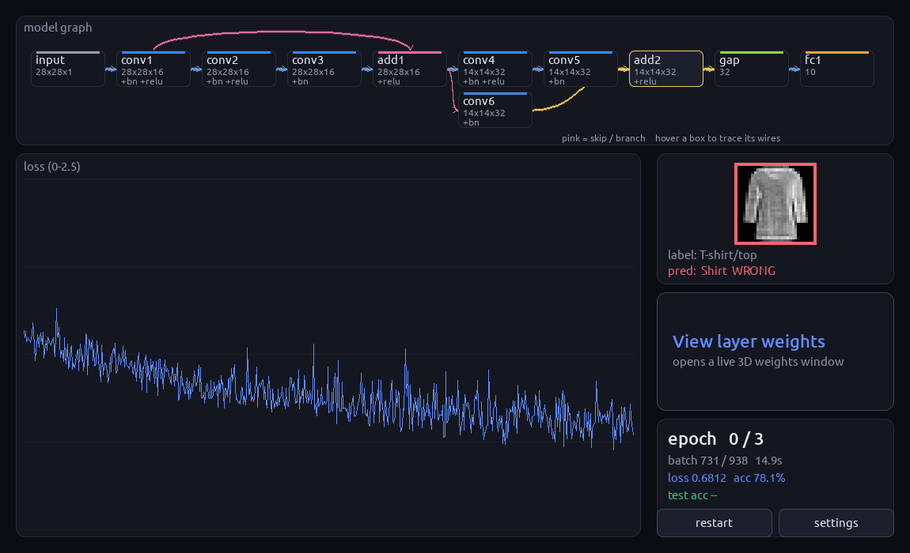
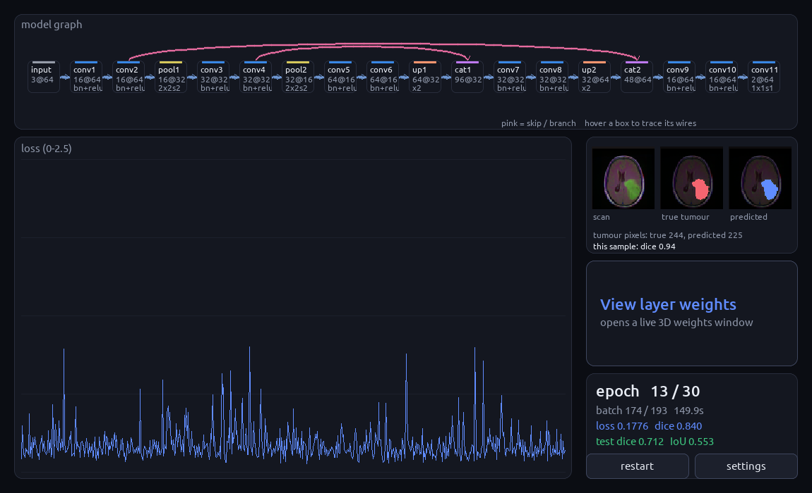
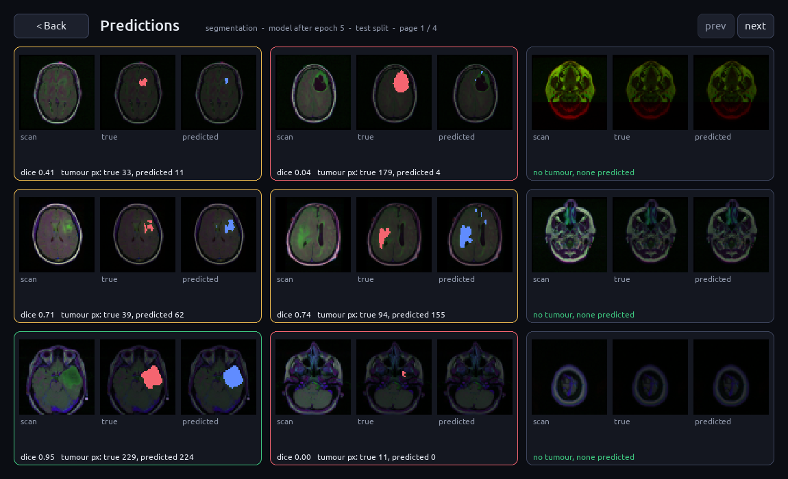

# Training dashboard

[< tinyDL](../README.md)

A **model graph** across the top (a box per layer with its output shape; relu / bn / gelu / tokens / pos are folded
into the box before them as `+bn +relu`, and a residual unit - the blocks between a fork and the add that joins it
again - collapses into one `attn` / `mlp block` / `res block` box; click its `[+]` corner to draw the blocks inside (framed,
with the residual skip as a pink arc; click the frame's `[-]` label to fold it again; an `attn` box has its own `[+]`
that opens it into its three steps - `q,k,v` projection, `attention`, `output proj` - with their shapes; the two
projections have a `[+]` too, which turns them into the `fc` they are, 32 -> 96 and 32 -> 32), hover a collapsed box to list
what is inside; other
skips, such as a U-Net's, are pink arcs; hover a box to trace its wires). A click on a box with weights opens the
weights window on that layer (the box of the layer the open window shows is outlined). Live weight thumbnails under
the boxes exist but are switched off (`ARCH_SHOW_WEIGHTS` in `train_viewer.c`), the loss curve, the current sample
(green border = predicted correctly), the running test accuracy, and the weights viewer. For segmentation
the sample box shows the scan, the true mask and the predicted mask side by side, and the numbers are the
batch's Dice and the test split's Dice / IoU. If the loss turns NaN, or a classifier's loss sits at
ln(#classes) (the network predicts one answer for everything, usually dead ReLUs after a too-high learning
rate), a red banner over the loss curve says so and suggests a fix.

The **stop** button (next to restart and settings) ends the run after the current batch: the dashboard keeps the last
curve and numbers, marked `stopped`, and `restart` starts again from scratch. Once the last batch has been reported
the button reads `done`.

A **GPU strip** under the loss curve shows the device (name, number of SMs), an estimate of how many SMs are busy
and how many are free, the video memory in use, temperature and power, updated about twice a second. The worker reads
them through NVML (`libnvidia-ml`, loaded at run time; without it only the SM count is shown). Be aware of what NVML
reports: *GPU utilization* is the share of time during which at least one kernel was running, not a count of busy
SMs, so "busy ~N of M" is that percentage times the SM count - an estimate (a small kernel that occupies a few SMs all
the time reads as 100%). The memory figure is for the whole device, every process included.

Segmentation (brain tumour U-Net; the nested pink arcs are the two encoder-decoder skips):

## Predictions page

"View predictions" (on the dashboard, or from the settings screen while a run exists) opens a page that shows
what the model says about a fixed set of samples spread over the test split (the training split if there is
none): 48 images with predicted / true class and confidence (green border = right, red = wrong), or for
segmentation 36 slices as scan / true mask / predicted mask with each slice's Dice (two thirds of them contain
tumour). The worker refreshes the set after every epoch, so the page can be left open to watch the model
improve, or opened after training has finished; `prev` / `next` or the arrow keys turn pages.

