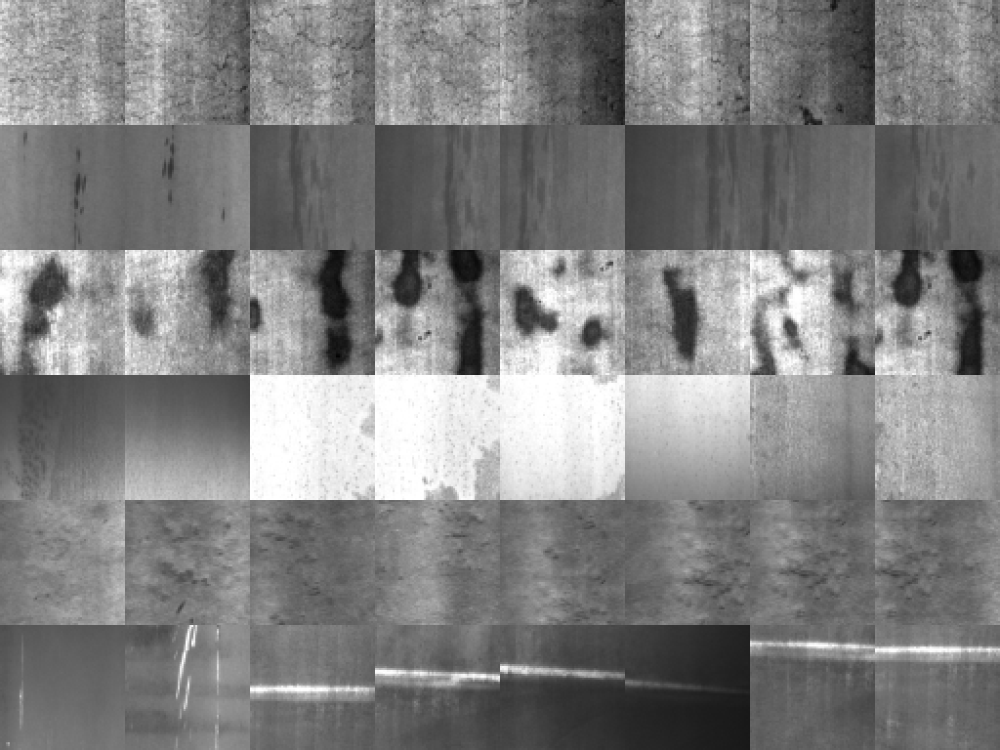

# Datasets

[< tinyDL](../README.md)

A dataset is a folder `data/<name>/` with IDX files (`train-images-idx3-ubyte`, `train-labels-idx1-ubyte`,
and optionally `t10k-*` for a test split evaluated every epoch). Images are grey or colour, up to
128x128, 2-16 classes. Colour images use a 4-dimensional variant (magic `0x00000804`: count, channels,
rows, cols, each image stored channel by channel). Optional `classes.txt` names the classes; optional
`defaults.txt` (`key value` lines: `epochs`, `batch_size`, `lr`, `momentum`, `normalize`, `augment`, `optimizer`)
is loaded into the form when the dataset is picked.

| dataset | get it | result |
|---|---|---|
| MNIST | `curl` below | ~97% (`test_mnist`) |
| Fashion-MNIST (GUI default) | `curl` below | ~88% in 3 epochs |
| NEU-CLS (steel defects, 6 classes, 1440 images) | `python3 tool/prepare_neu_cls.py` | ~90% (CNN), 88-93% (ResNet) |
| CIFAR-10 (colour, 10 classes) | `python3 tool/prepare_cifar10.py` | ~73% after 10 epochs (ResNet, width 32) |
| Brain MRI tumour segmentation (LGG, 3929 slices) | `python3 tool/prepare_brain_mri.py` | test Dice ~0.82, IoU ~0.70 (U-Net, 30 epochs) |

```bash
# MNIST (Fashion-MNIST: BASE=http://fashion-mnist.s3-website.eu-central-1.amazonaws.com, into data/fashion-mnist)
mkdir -p data/mnist && cd data/mnist
BASE=https://ossci-datasets.s3.amazonaws.com/mnist
for f in train-images-idx3-ubyte train-labels-idx1-ubyte t10k-images-idx3-ubyte t10k-labels-idx1-ubyte; do
  curl -sS -o "$f.gz" "$BASE/$f.gz" && gunzip -f "$f.gz"
done
cd -

pip install pyarrow numpy pillow          # for the converters
```

Notes from training the harder sets: NEU-CLS needs per-epoch shuffling (the files are sorted by class),
standardization, momentum 0.9, flips and lr ~6e-3 for the CNN (its `defaults.txt` has them); a residual
network does not beat the CNN on 1440 images. The CIFAR-10 run was stopped at epoch 10 of 15
(about 50 s/epoch), so ~73% is a partial result, not a tuned one.

**Segmentation datasets** have a third pair of files, `train-masks-idx3-ubyte` / `t10k-masks-idx3-ubyte` (IDX
magic `0x803`: count, rows, cols, then one class index per pixel); their presence is what makes the trainer treat a
folder as segmentation. The loss is per-pixel cross entropy plus a soft Dice term (the tumour is only ~1% of the
pixels, so cross entropy alone settles on "all background"), computed on the host like the classification loss.
Augmentation moves the mask exactly like the image.

`tool/prepare_brain_mri.py` converts the [LGG brain MRI set](https://huggingface.co/datasets/gymprathap/Brain-Tumor-Segmentation)
(110 TCGA patients, 3-channel FLAIR slices with a tumour mask) to 64x64 (`--size 128` for more detail), split
**by patient** (88 train / 22 test) so that neighbouring slices of one patient never land on both sides of the
split. The U-Net preset has 119k parameters and trains at about 11 s per epoch at 64x64; the numbers above are
from one 30-epoch run on the held-out patients (they move by a few points from epoch to epoch).


