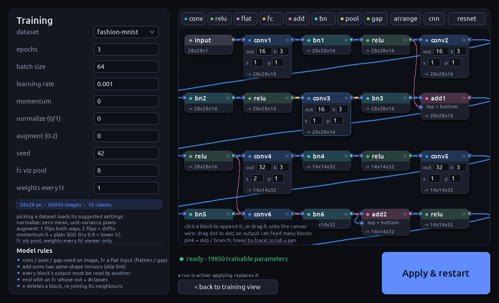

# Model editor

[< tinyDL](../README.md)

The model is a graph: a node reads the output of whatever its input dot is wired to, and one output
can feed several nodes, so branches and skip connections work.

| block | parameters | needs |
|---|---|---|
| conv | out channels 1-64, kernel 1-7, stride 1-4, padding 0-3 | an image |
| relu | | anything |
| bn | learned scale and shift per channel; batch size >= 2 | anything |
| pool | max pool, window 1-4, stride 1-4 | an image |
| gap | global average pool, gives C values (already flat) | an image |
| up | nearest-neighbour upsample, factor 1-4 | an image |
| add | two inputs, summed | two tensors of the same shape |
| cat | two inputs joined along the channels | two images of the same height and width |
| flatten | (C,H,W) to C*H*W values | an image |
| fc | out features 1-4096; on a token sequence it is applied to every token | a flat input, or a token sequence |
| view | reshape a flat vector into a (channels, height, width) map | a flat input of exactly c*h*w values |
| ln | layer norm: every position is normalized across its channels; learned scale and shift | anything |
| gelu | | anything |
| patch | cuts the image into non-overlapping patches (size 1-32) and flattens each into one token: (C*size*size, H/size * W/size, 1). No parameters - it only re-indexes; the projection to the model width is the `fc` after it | an image whose sides are multiples of the size |
| gray | colour to gray: (3, H, W) -> (1, H, W), 0.299 R + 0.587 G + 0.114 B. No parameters | a 3-channel image |
| tokens | (C,H,W) to a sequence of H*W tokens, shape (C,H*W,1) | an image |
| pos | learned position embedding, one value per position and channel | an image / token sequence |
| attn | multi-head self-attention with its own q,k,v and output projections (they are not convolutions and are not drawn); parameter = heads; D channels in and out | a token sequence, channels a multiple of heads |
| vae | the VAE sampling step: 2*Z values (mean, log-variance) in, Z values out; parameter = KL weight | a flat input; at most one per model |

The graph must end in one value per class (classification: an fc block), in a map with one channel per class at
the full image size (segmentation dataset: a 1x1 conv), or, if it contains a `vae` block, in an image the size
of the input. Limits are 48 blocks and 16 conv + fc layers.

- **Build** — the editor starts empty (just `input` and `output`). Open the `blocks` menu (top left): it lists the basic blocks - each one a single operation (conv, relu, flat, fc, bn, pool, gap, add, cat, up, view, vae, ln, gelu, tokens, pos) - then a `preprocessing` section (patch, gray) beside them, and keeps the advanced ones, the blocks made of other blocks (attn, res block, attn block, mlp block), folded under `advanced`. A `res block`, `attn block` or `mlp block` drops its whole row of wired nodes at once (e.g. ln - attn - add); wire its first input and the add's second input yourself. `patch` and `gray` are preprocessing blocks: they have no weights, are not counted as network layers, and must read the `input` node directly (the editor refuses other wires). Click a block to
  drop it on the canvas, or drag it where you want it. Blocks arrive unwired - pull the wires yourself; or drag it onto the canvas. Drag from an output dot
  to an input dot to wire; grab a wired input dot to move its wire; `x` deletes a block and re-joins its
  neighbours; `arrange` lays the nodes out in evaluation order and zooms to fit them all.
- **Zoom and pan** — scroll to zoom around the cursor (35%-200%), drag the background to pan, shift + scroll to pan
  sideways; the bar at the canvas's bottom right has `-` / `+` and `fit` (show every node). A big graph such as the
  U-Net is shown whole after `arrange` or loading a preset, and you zoom in to edit a block.
- **Presets** (the menu next to `arrange`; nothing is loaded until you pick one, `empty` clears the canvas) —
  Classification: `cnn` (4 conv + fc), `resnet`
  (stem, an identity residual block, a stride-2 block with a 1x1-conv shortcut, global average pool, fc) and `mlp`
  (flatten and three fc layers) and `vit` (a small vision transformer, see [transformer](transformer.md));
  Segmentation: `unet` (two downsampling levels, nearest upsampling + concat skips, 1x1 conv head); Generation:
  `vae` (see [generative model](vae.md)). The `blocks` menu follows the problem too: Classification has `flat`, `fc`, `gap` but no
  `up` / `cat`; Segmentation has `up` / `cat` but no `flat` / `fc` / `gap`; `view` and `vae` appear only under
  Generation.
- **Errors** — a block that breaks a rule gets a red border and a callout under it saying why (the status line
  repeats it). Two common mistakes have a one-click fix in the callout: an fc / `view` / `vae` block fed an image
  (`insert a flatten block`) and a last fc whose width is not the class count (`set out to N`).
- **Inside an attention block** — the `[+]` at the bottom right of an `attn` node opens a read-only popover with its
  three steps (`q,k,v` fc, `attention`, `output proj` fc); a click on `q,k,v` or `output proj` shows the fc inside it
  (shapes, weight count, and the q | k | v split of the first one). It only shows the structure: the block is still
  one block with a single parameter, the heads.
- **Units** — a residual unit (the blocks between a fork and the add that joins the two paths again, such as
  `ln - attn - add` or `ln - fc - gelu - fc - add`) gets a labelled frame (`attn block`, `mlp block`, `res block`),
  and `arrange` puts every expanded unit on a row of its own. Click `[-]` on a frame to collapse the unit into one
  box (a click on the box, `[+]`, expands it again): its blocks are neither drawn nor clickable, but still part of the
  model, and the wires attach to the box. The `resnet` and `vit` presets start collapsed.
- **Read the graph** — wires are blue between neighbours in evaluation order and pink for skips and
  branches; hover a block to light up everything it reads and everything that reads it.

