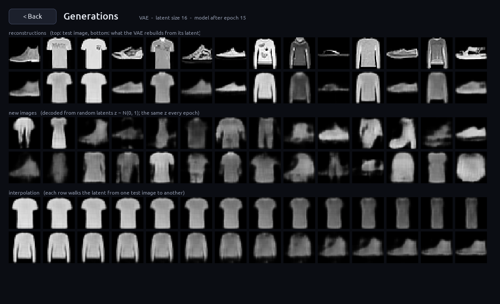

# Generative model (VAE)

[< tinyDL](../README.md)

Choose **Generation** at the top: the model must contain exactly one `vae` block (a Classification problem
with a `vae` block, or a Generation one without, is reported in red). No labels are used, so any image dataset
works, and the `vae` preset is rebuilt for each: a convolutional encoder (stride-2 convs until the map is at most
11 pixels across, an fc to 2x16 numbers), the sampling step, and the mirrored decoder (fc, `view`, upsample + conv
stages). The decoder's output is read as logits: the loss is binary cross
entropy against the raw pixels, summed over the pixels, plus the KL weight times the KL divergence, averaged over
the batch; the KL gradient is added by the sampling block's backward pass, so the reconstruction and the KL
need no separate machinery. Everything after the sampling block may read only the latent, which is what lets
the trainer run the decoder alone on random latents.

"View generations" shows, refreshed every epoch: test images above their reconstructions, 28 new images decoded from
fixed random latents (the same latents every epoch, so you can watch them sharpen), and two interpolations
between the latents of pairs of test images. The dashboard shows the input and reconstruction of the latest
batch, and the chart is per pixel.

On Fashion-MNIST (15 epochs, about 8 s each, Adam with lr 0.001, which the preset selects) the test reconstruction
loss settles at about 0.282 per pixel with a KL of ~17 nats, i.e. roughly 221 + 17 = 238 nats per image. That is
close to what convolutional VAEs with a Bernoulli decoder reach on this dataset, so the plateau is the model
(a 16-dimensional latent and a KL weight of 1), not the optimizer: plain SGD with momentum reaches 0.285. The
look is the usual one for a plain VAE: reconstructions are recognisable (garment type and shape) but soft, and
new images are blurry garment-like shapes. Lowering the KL weight (the `vae` block's field) trades sample quality
for sharper reconstructions.
