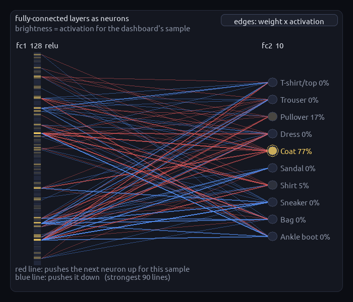

# Weights viewer

[< tinyDL](../README.md)

Clicking a box of the model graph on the training screen opens a second window on that layer's weights - there is
no tab bar, the model graph is the navigation (click another box to look at another layer). It is updated live: conv
filters are drawn in 3D as bars (height = weight, blue < 0 < red; drag to rotate, scroll to zoom, `0` resets). An fc
layer has no weight picture - its box opens the **network** view (below), the neurons.

A conv layer's corner button `result >` (`< filters` goes back) shows what the convolution *produced*: one small
image per output channel, for the sample the dashboard is showing, updated every batch (each map is scaled to its own
min..max). It is the layer's output before its relu / batch norm.

A fully-connected weight matrix has no spatial structure (its rows are arbitrary features), so it looks like noise as a
picture; the **network** view shows the fc layers as neurons instead:

- each layer is a column of neurons (a strip of thin cells when there are many), **brightness = that neuron's
  activation for the sample the dashboard is showing**, updated every batch; a classifier's last layer is labelled
  with the class names and probabilities, the winner ringed;
- the **strongest 90 connections** between neighbouring layers are drawn as lines: by default weight x activation, i.e.
  what pushes the next neuron up (red) or down (blue) *for this sample*, so you can see which hidden neurons drive a
  decision; the button in the corner switches to the plain weight;
- an fc layer is an n x m matrix, so it is drawn as n dots on its left and m dots on its right; what feeds the first
  layer (the flatten's values, the gap's, the VAE's latent) is the left column, with the sample's own values as its
  brightness (up to 4096 values; more are drawn dark). A matrix that was sent pooled draws each line from the middle
  of the dots it stands for;
- layers whose weights were sent pooled (more than 32768 weights) draw no connections.

The `mlp` preset (flatten, fc 64, fc 32, fc) is the model this view is made for.

